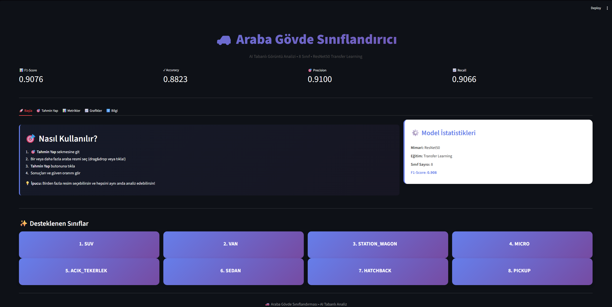
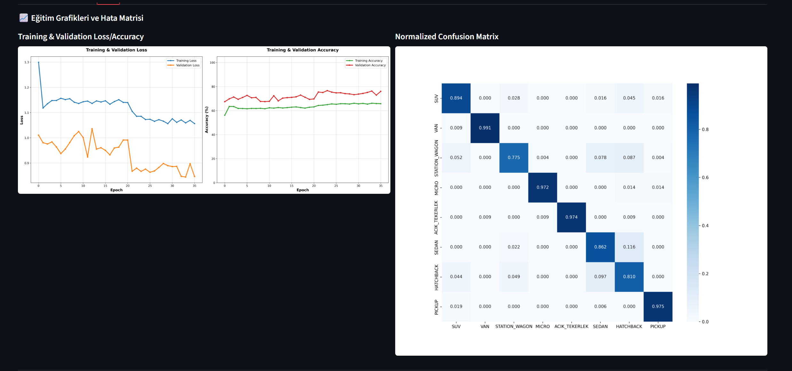

# Araç Gövde Tipi Sınıflandırma

Araç fotoğrafından gövde tipini (SUV, Sedan, Hatchback, Station Wagon, Pick-Up, Van, Micro, Açık Tekerlek) tahmin eden bir görüntü sınıflandırma projesi. Model ResNet50 üzerine transfer learning ile eğitildi, arayüz Streamlit ile yapıldı.


| Ana sayfa | Tahmin yap |
|---|---|
|  |  |
| **Grafikler** | **Model bilgisi** |
|  |  |

## Sonuçlar (test seti)

| Metrik | Değer |
|---|---|
| Accuracy | 0.882 |
| F1 (macro) | 0.908 |
| F1 (weighted) | 0.883 |
| Precision (macro) | 0.910 |
| Recall (macro) | 0.907 |

Sınıf bazlı sonuçlar ve karışıklık matrisi `models/model_info.json` dosyasında ve `reports/` klasöründe.

## Model

- ResNet50 (ImageNet ağırlıklarıyla başlıyor), sonuna 2048 > 1024 > 512 > 8 sınıf olacak şekilde tam bağlantılı katmanlar eklendi (BatchNorm, ReLU, Dropout)
- Transfer learning ve fine-tuning, 68 epoch, SGD + momentum, early stopping
- Veri artırma: döndürme, ölçekleme, kaydırma, ColorJitter, RandomCrop, RandomErasing
- Tahminde TTA kullanılıyor (orijinal, yatay çevrilmiş ve kırpılmış görüntülerin ortalaması)

## Kullanılan kütüphaneler

Python, PyTorch, torchvision, Streamlit, Plotly, Matplotlib, Seaborn, scikit-learn

## Çalıştırma

```
pip install -r requirements.txt
git lfs pull
streamlit run app.py
```

Eğitilmiş model (`models/best_model.pt`, yaklaşık 150 MB) Git LFS ile repoda duruyor, o yüzden `git lfs pull` gerekiyor (kurulu değilse https://git-lfs.com).

Modeli yeniden eğitmek için:

```
python train_model_pytorch.py --device cpu
```

(`cuda` ya da `dml` de verilebilir.) Windows'ta `RUN.bat` sanal ortamı kurup eğitimi ve arayüzü başlatıyor.

## Diğer dosyalar

Veri setini hazırlamak ve temizlemek için `split_dataset.py`, `merge_external_dataset.py`, `scan_bad_images.py`, `audit_mislabeled_images.py`, `fix_labels_from_audit.py`; değerlendirme için `evaluate_model.py`, `show_confused.py`, `show_errors.py`; teslim dosyaları için `prepare_submission.py`, `verify_submission.py` var.
