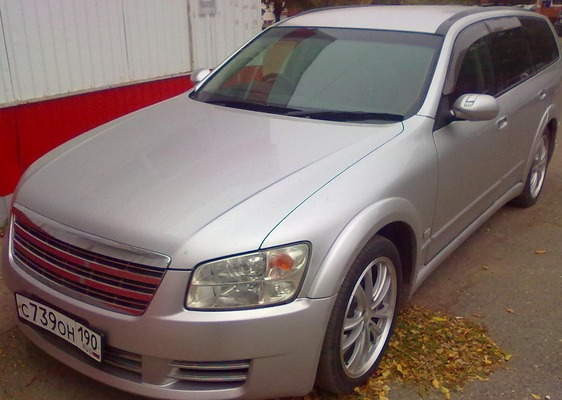
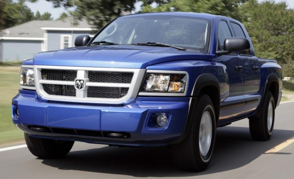
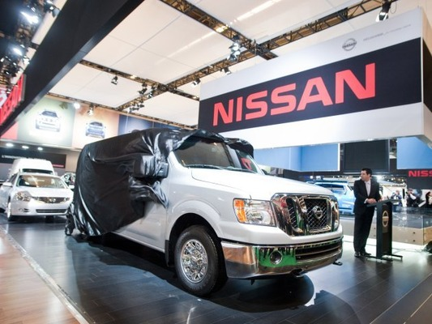
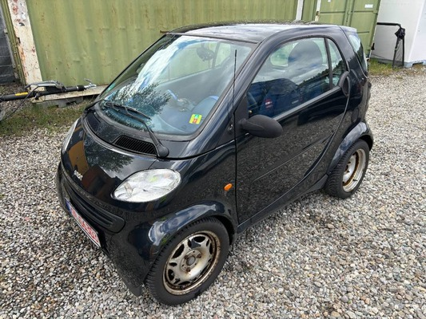
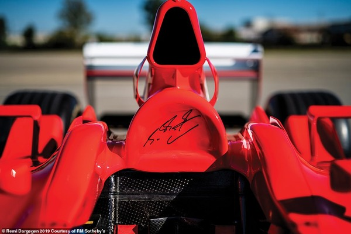

# 🚗 AutoVision: Araç Gövde Tipi Sınıflandırma ve XAI Teşhis Sistemi

[](https://pytorch.org/)
[](https://github.com/microsoft/DirectML)
[](https://streamlit.io/)
[](#sonuçlar-ve-başarım-metrikleri)
[](#sonuçlar-ve-başarım-metrikleri)

Araç fotoğraflarından gövde tipini (**SUV, Sedan, Hatchback, Station Wagon, Pick-Up, Van, Micro, Açık Tekerlek**) yüksek doğrulukla tespit eden, **Grad-CAM (Açıklanabilir Yapay Zeka - XAI)** ısı haritası ve **4x Test-Time Augmentation (TTA)** destekli modern bir derin öğrenme projesidir.

Proje, **Kocaeli Üniversitesi Bilgisayar Mühendisliği Bölümü Yazılım Laboratuvarı 2 (YazLab 2) 3. Proje** kapsamında geliştirilmiştir.

---

## 🌟 Öne Çıkan Özellikler

* **Derin Öğrenme Omurgası:** ResNet-50 mimarisi üzerine özel tasarlanmış tam bağlantılı sınıflandırma katmanı (`2048 → 1024 → 512 → 8 Sınıf`, BatchNorm1d + ReLU + Dropout).
* **Açıklanabilir Yapay Zeka (Grad-CAM XAI):** Modelin araç gövdesini sınıflandırırken aracın neresine odaklandığını (kasa çizgisi, bagaj eğimi, tavan yüksekliği, açık tekerlek vb.) gösteren dinamik ısı haritası katmanı.
* **4x Test-Time Augmentation (TTA):** Tahmin anında yatay simetri ve kenar kırpmalarıyla çoklu varyant ortalaması alarak sınıflandırma kararlılığı sağlar.
* **Oran Koruyucu Ön İşleme (Letterboxing):** Araç fotoğraflarının en-boy oranını bozmadan 224×224 boyutunda gri zemin üzerinde kareye tamamlar.
* **Donanım Hızlandırması (Cross-Platform):** Windows üzerinde **AMD Radeon DirectML (`torch-directml`)**, **NVIDIA CUDA** ve **Çok Çekirdekli CPU** otomatik algılama desteği (~50 ms çıkarım süresi).
* **Çoklu Girdi Akışı:**
  1. 📁 Yerel dosya yükleme (tekli veya toplu drag & drop)
  2. 🌐 Doğrudan web görsel bağlantısı (URL) ile test
  3. 📸 Web kamerasından anlık canlı araç çekimi
  4. 🎲 Test veri setinden tek tıkla rastgele araç çekme simülasyonu

---

## 🚘 Desteklenen 8 Araç Gövde Tipi

| Sınıf | Temsili Görsel | Yapısal Tanım ve Anahtar Özellikler |
|:---:|:---:|---|
| **SUV** |  | Yüksek sürüş pozisyonu, yüksek taban mesafesi, 2-kutu gövde ve geniş çamurluk açıklığı. |
| **SEDAN** |  | Belirgin motor, yolcu kabini ve bağımsız bagaj çıkıntısı olan klasik 3-kutu gövde yapısı. |
| **HATCHBACK** |  | Bagaj kapağı arka camla birlikte yukarı açılan, kısa arka çıkıntılı 2-kutu kompakt gövde. |
| **STATION WAGON** |  | Sedan şasisi üzerine tavan çizgisi aracın en arkasına kadar uzatılmış, D-sütunlu geniş bagajlı gövde. |
| **PICK-UP** |  | Yolcu kabini arkasında açık yük taşıma kasası bulunan, yüksek taşıma şasili arazi/ticari aracı. |
| **VAN** |  | Yüksek kutu tavanlı monoblok gövde, dik burun açısı ve sürgülü yan kapılar. |
| **MICRO** |  | Ultra kısa dingil mesafesi (< 3 metre), 2 kişilik kompakt şehir içi mini gövde. |
| **AÇIK TEKERLEK** |  | Tekerlekleri çamurlukla örtülmemiş, aerodinamik yarış veya özel spor gövdesi (Formula, karting vb.). |

---

## 📊 Sonuçlar ve Başarım Metrikleri (Test Seti)

Model, eğitim sırasında hiç görmediği **1.437 adet bağımsız test görseli** üzerinde değerlendirilmiştir:

### Genel Başarım
| Metrik | Değer |
|---|---|
| **Test Doğruluğu (Accuracy)** | **%88.23** |
| **F1-Skor (Macro Average)** | **0.9076** |
| **F1-Skor (Weighted Average)** | **0.8827** |
| **Kesinlik (Precision - Macro)** | **0.9100** |
| **Duyarlılık (Recall - Macro)** | **0.9066** |
| **Ortalama Çıkarım Gecikmesi** | **~54 ms** (AMD DirectML GPU) |

### Sınıf Bazında Başarım Detayı
| Sınıf | F1-Skor | Kesinlik (Precision) | Duyarlılık (Recall) |
|---|:---:|:---:|:---:|
| **VAN** | **0.9910** | 0.9910 | 0.9910 |
| **AÇIK TEKERLEK** | **0.9869** | 1.0000 | 0.9741 |
| **MICRO** | **0.9722** | 0.9722 | 0.9722 |
| **PICK-UP** | **0.9688** | 0.9627 | 0.9748 |
| **SUV** | **0.8943** | 0.8943 | 0.8943 |
| **SEDAN** | **0.8510** | 0.8404 | 0.8618 |
| **STATION WAGON** | **0.8249** | 0.8818 | 0.7749 |
| **HATCHBACK** | **0.7722** | 0.7379 | 0.8097 |

---

## ⚙️ Model Eğitimi ve Veri Pipeline'ı

* **Veri Çoğaltma (Data Augmentation):**
  * Döndürme: ±18° ve Perspektif Deformasyonu
  * Rastgele Ölçekleme ve Kaydırma (Affine Translation ±15%)
  * Renk Değişimi: ColorJitter (Parlaklık 0.3, Kontrast 0.3, Doygunluk 0.25)
  * RandomErasing: Aşırı uyumu (overfitting) önlemek amacıyla kısmi blok silme
* **Eğitim Parametreleri:**
  * Optimizer: SGD w/ Nesterov Momentum (lr_head=1e-3, lr_base=1e-4)
  * Zamanlayıcı: Linear Warmup + ReduceLROnPlateau (Sabır: 12)
  * Kayıp Fonksiyonu: Label Smoothing (0.05) ile CrossEntropyLoss

---

## 🚀 Kurulum ve Çalıştırma

### 1. Gereksinimlerin Yüklenmesi
```bash
# Git LFS ile model ağırlıklarını çekin (~150 MB)
git lfs pull

# Gerekli bağımlılıkları yükleyin
pip install -r requirements.txt
```

### 2. Arayüzün Başlatılması
```bash
# Sanal ortam aktifken Streamlit kokpitini başlatın:
python -m streamlit run app.py
```
*(Windows kullanıcıları doğrudan `RUN.bat` dosyasına çift tıklayarak ortamı ve arayüzü tek adımda başlatabilir.)*

Tarayıcınızda otomatik olarak **`http://localhost:8501`** adresi açılacaktır.

---

## 🛠️ Yardımcı Betikler

* `evaluate_model.py`: Test seti üzerinde güncel modelin tüm metriklerini ve karışıklık matrisini hesaplar.
* `audit_mislabeled_images.py`: Eğitim setinde yüksek güvenle farklı sınıfa benzeyen şüpheli/hatalı etiketli görselleri tespit eder.
* `fix_labels_from_audit.py`: Tespit edilen bariz etiket hatalarını otomatik olarak doğru klasöre taşır.
* `show_confused.py`: En çok birbirine karışan sınıfları (Hatchback/Sedan/SW) ayrı bir klasöre toplayarak görsel denetim sağlar.
* `prepare_submission.py`: Modeli FP16 (75 MB) formatına sıkıştırarak teslimat paketini hazırlar.

---

## 👥 Akademik Künye

Bu proje, **Kocaeli Üniversitesi Bilgisayar Mühendisliği** dersi kapsamında geliştirilmiştir:

* 👨‍💻 **Berat Batuhan Şahin** — `230201026`
* 👨‍💻 **Emirhan Çalık** — `230201108`
* 🏛️ **Kocaeli Üniversitesi** • Bilgisayar Mühendisliği Bölümü
* 📄 **Akademik Bildiri:** IEEE Formatında Hazırlanan Rapor Dosyası ([rapor.tex](rapor.tex))
