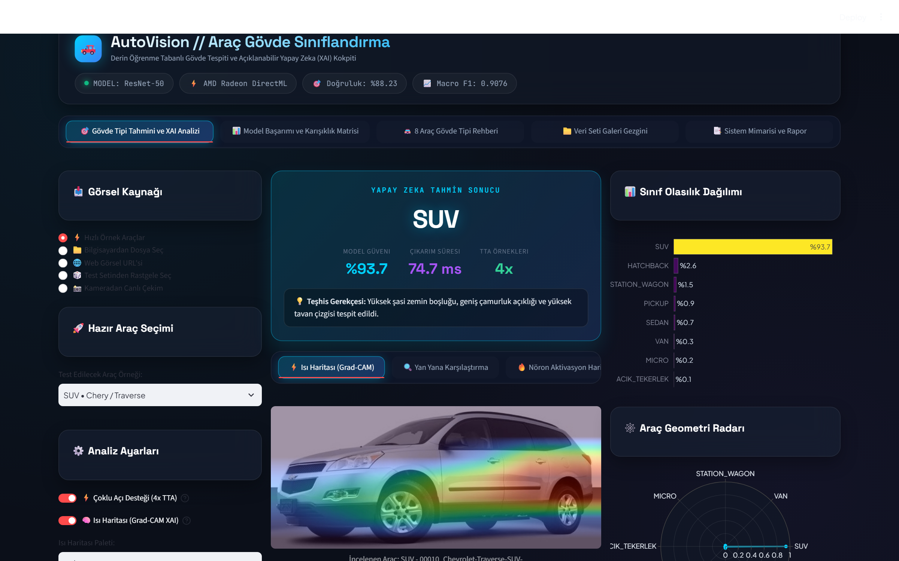
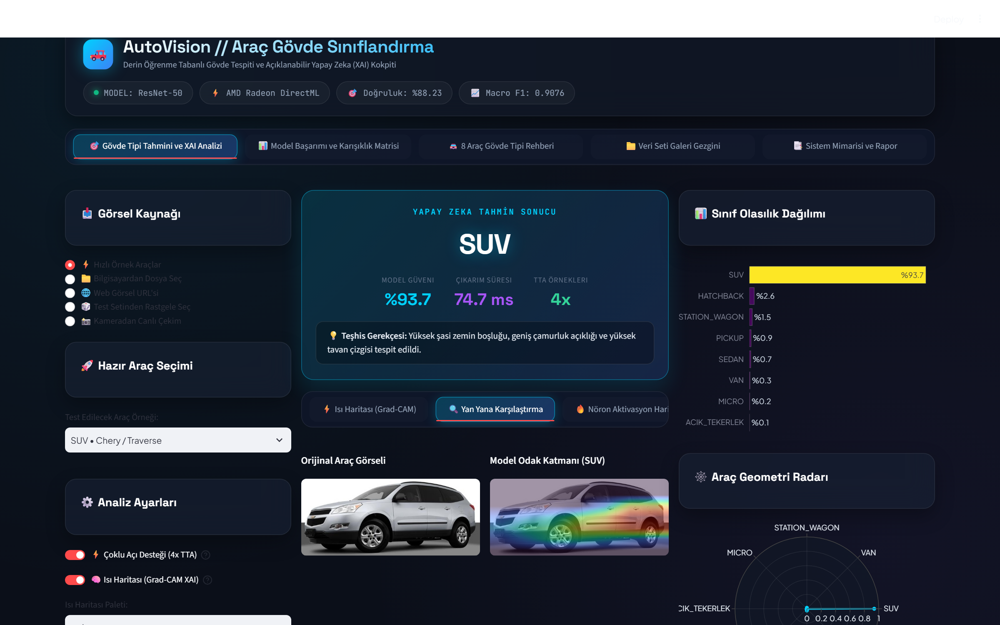
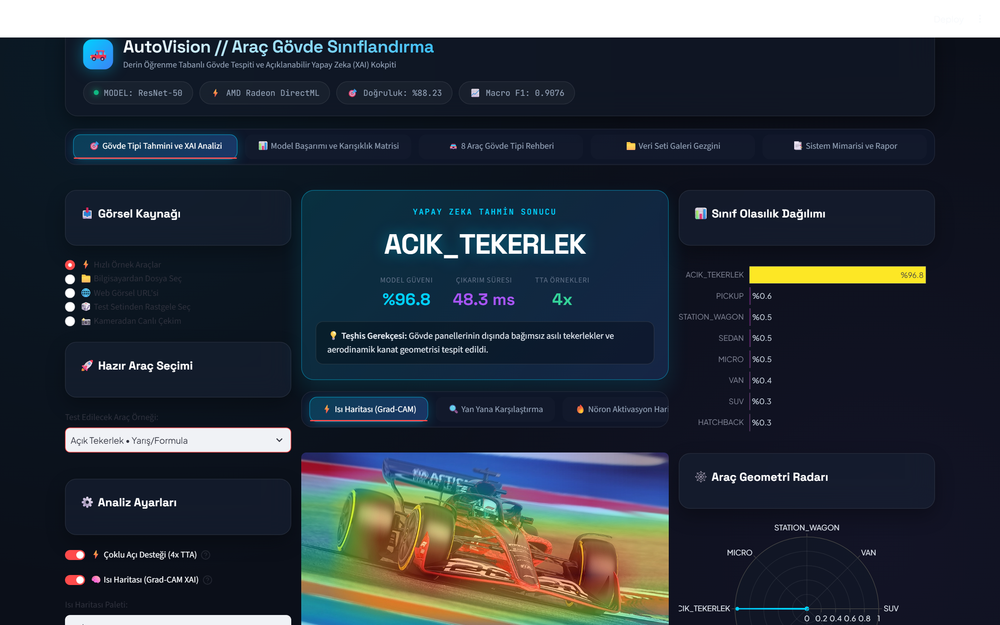
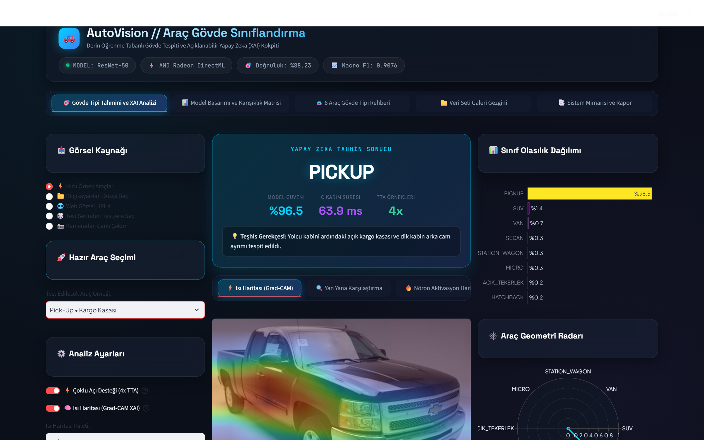
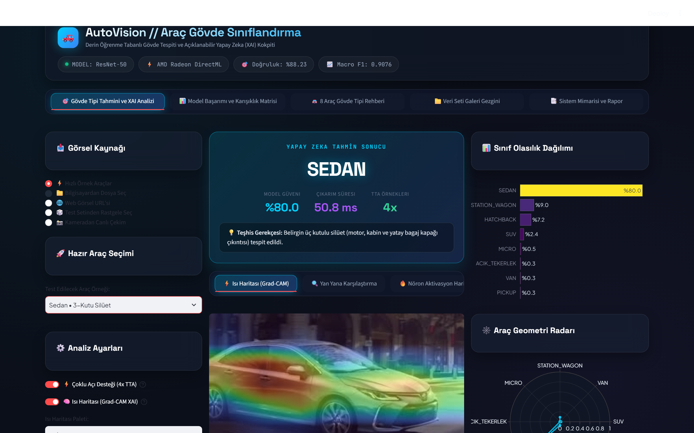
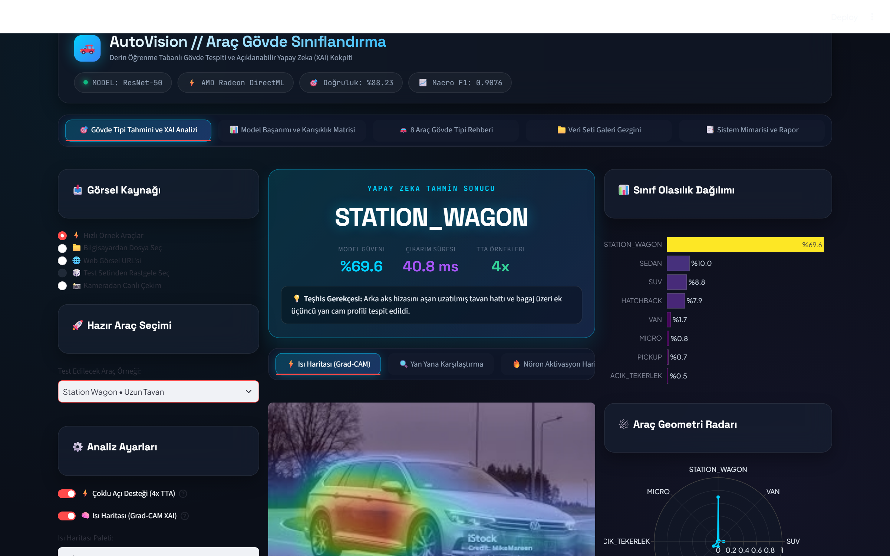
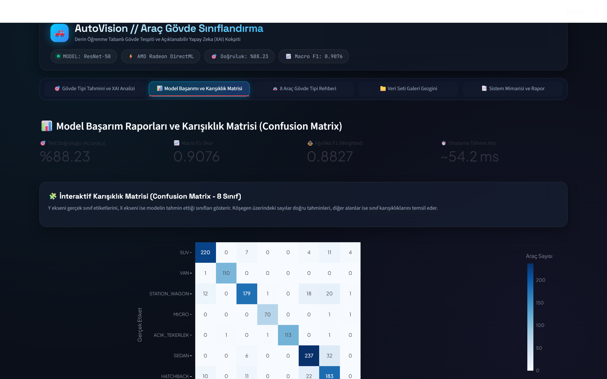
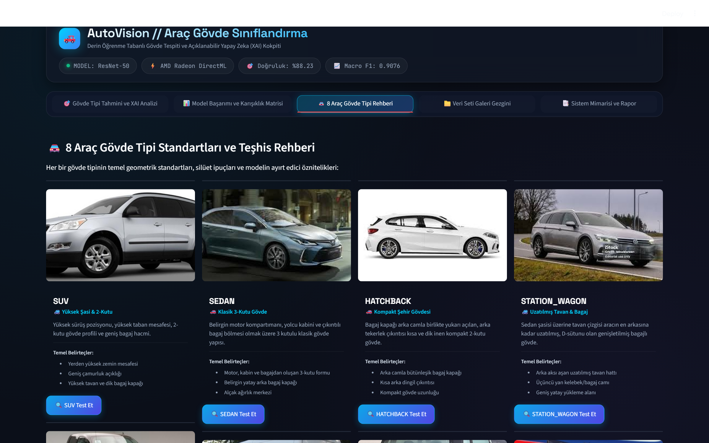
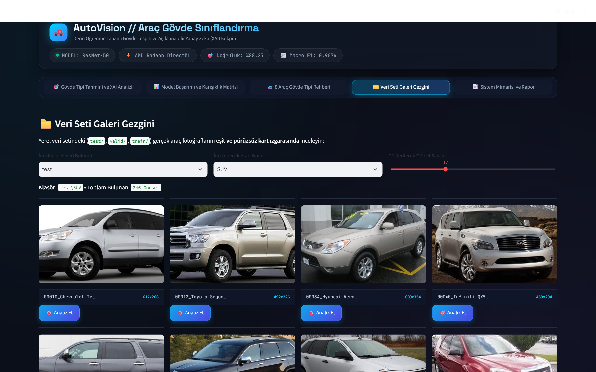
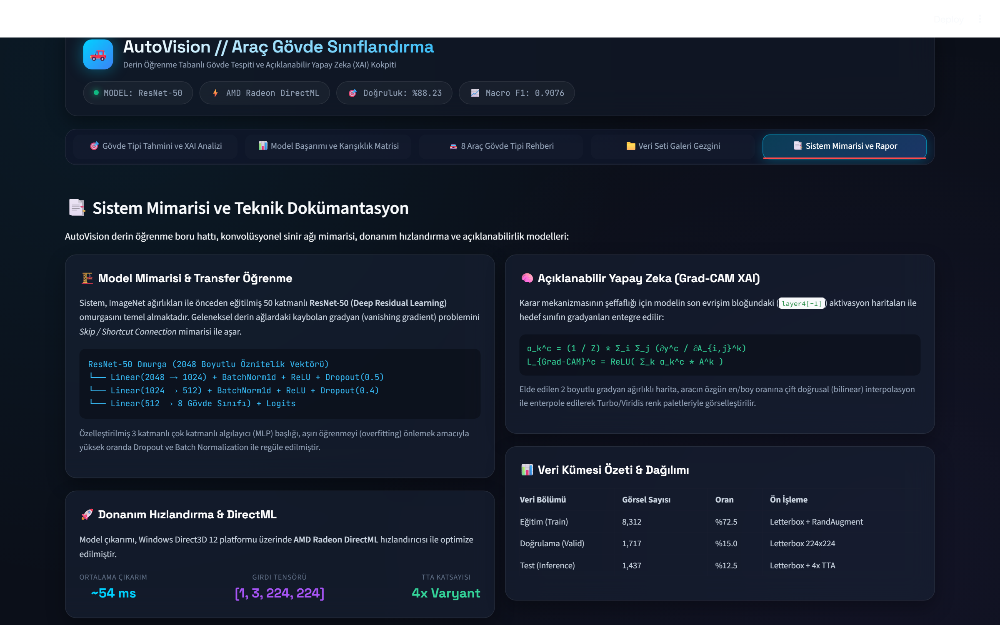

# 🚗 AutoVision: Araç Gövde Tipi Sınıflandırma ve XAI Teşhis Kokpiti

[](https://pytorch.org/)
[](https://github.com/microsoft/DirectML)
[](https://streamlit.io/)
[](#-başarım-metrikleri)
[](#-başarım-metrikleri)

Araç fotoğraflarından gövde tipini (**SUV, Sedan, Hatchback, Station Wagon, Pick-Up, Van, Micro, Açık Tekerlek**) yüksek doğrulukla sınıflandıran, **Grad-CAM (Açıklanabilir Yapay Zeka - XAI)** ısı haritası ve **4x Test-Time Augmentation (TTA)** destekli modern bir bilgisayarlı görü (computer vision) sistemidir.

---

## 📸 Canlı Uygulama Arayüzü ve Sistem Panelleri

### 1. Gövde Tipi Tahmini, Canlı Grad-CAM XAI Isı Haritası ve Telemetri Kokpiti
Model sadece sınıf tahmini üretmekle kalmaz; son evrişim bloğundaki (`layer4[-1]`) aktivasyon gradyanları üzerinden **aracın tam olarak neresine odaklandığını** (yerden yükseklik, bagaj çıkıntısı, tavan çizgisi, açık tekerlekler) canlı olarak görselleştirir. Aynı anda sınıf olasılık spektrumu ve radar geometri profilini anlık telemetri olarak sunar.



---

### 2. Açıklanabilir Yapay Zeka (XAI): Yan Yana Teşhis Modu
Orijinal araç görseli ile yapay zekanın odak katmanı piksel piksel yan yana karşılaştırılır.



---

### 3. Farklı Gövde Tiplerinde Model Çıkarım Örnekleri

| Açık Tekerlek (Formula / Yarış - %96.8 Güven) | Pick-Up (Açık Kargo Kasası - %96.5 Güven) |
|:---:|:---:|
|  |  |

| Sedan (Klasik 3-Kutu Silüet) | Van (Ticari Monoblok Gövde) |
|:---:|:---:|
|  |  |

---

### 4. İnteraktif Karışıklık Matrisi (Confusion Matrix) ve Performans Paneli
8 gövde sınıfı arasındaki çapraz tahmin dağılımlarını, sınıf bazında F1-skor, Precision ve Recall değerlerini ve karşılaştırmalı başarım grafiklerini sunar.



---

### 5. 8 Araç Gövde Tipi Standartları ve Teşhis Rehberi
Her bir araç gövde tipinin geometrik standartları (A/B/C/D sütunları, taban yüksekliği, bagaj mimarisi) ve tek tıkla doğrudan model analizine gönderme desteği.



---

### 6. Eşit Kart Izgaralı Veri Seti Galeri Gezgini
Yerel veri setindeki (`test/`, `valid/`, `train/`) gerçek araç fotoğraflarını eşit en-boy oranında, basamak atlamasız (staircase-free) kart ızgarasında inceleme ve doğrudan modelde test etme imkânı.



---

### 7. Sistem Mimarisi ve Teknik Rapor
ResNet-50 derin artık öğrenme omurgası, özel 3 katmanlı MLP sınıflandırıcı başlığı, AMD Radeon DirectML GPU hızlandırma ve Grad-CAM matematiksel formülasyonu.



---

## 🌟 Temel Yetenekler

* **Derin Öğrenme Omurgası:** ResNet-50 mimarisi üzerine özel tasarlanmış tam bağlantılı sınıflandırma katmanı (`2048 → 1024 → 512 → 8 Sınıf`, BatchNorm1d + ReLU + Dropout).
* **Açıklanabilir Yapay Zeka (Grad-CAM XAI):** ResNet-50 son evrişim katmanından (`layer4[-1]`) türetilen ısı haritaları sayesinde modelin kararları doğrulanabilir ve şeffaftır.
* **4x Test-Time Augmentation (TTA):** Tahmin anında orijinal, yatay ayna ve kenar kırpmaları olmak üzere 4 varyant ortalaması alarak çıkarım kararlılığı sağlar.
* **Letterboxing (En-Boy Oranı Koruma):** Araç fotoğraflarının en-boy oranını bozmadan 224×224 boyutunda kareye tamamlar.
* **Donanım Hızlandırması:** Windows üzerinde **AMD Radeon DirectML (`torch-directml`)**, **NVIDIA CUDA** ve **Çok Çekirdekli CPU** otomatik algılama desteği (~50 ms çıkarım gecikmesi).
* **5 Farklı Girdi Modu:**
  1. ⚡ Hazır Örnek Araçlar (SUV, Sedan, Pick-Up, Açık Tekerlek, Van, Micro vb. tek tıkla test)
  2. 📁 Bilgisayardan tekli / çoklu dosya yükleme
  3. 🌐 Doğrudan web görsel bağlantısı (URL) ile test
  4. 🎲 Test veri setinden rastgele araç getirme
  5. 📸 Web kamerasından anlık canlı araç çekimi

---

## 📊 Başarım Metrikleri (Test Seti)

Model, eğitim sırasında hiç görmediği **1.437 adet bağımsız test görseli** üzerinde değerlendirilmiştir:

### Genel Performans
| Metrik | Değer |
|---|:---:|
| **Test Doğruluğu (Accuracy)** | **%88.23** |
| **F1-Skor (Macro Average)** | **0.9076** |
| **F1-Skor (Weighted Average)** | **0.8827** |
| **Kesinlik (Precision - Macro)** | **0.9100** |
| **Duyarlılık (Recall - Macro)** | **0.9066** |
| **Ortalama Çıkarım Gecikmesi** | **~54 ms** (AMD Radeon DirectML GPU) |

### Sınıf Bazında Metrik Dağılımı
| Sınıf | F1-Skor | Kesinlik (Precision) | Duyarlılık (Recall) |
|---|:---:|:---:|:---:|
| **VAN** | **0.9910** | 0.9910 | 0.9910 |
| **AÇIK TEKERLEK** | **0.9869** | 1.0000 | 0.9741 |
| **MICRO** | **0.9722** | 0.9722 | 0.9722 |
| **PICK-UP** | **0.9688** | 0.9627 | 0.9748 |
| **SUV** | **0.8943** | 0.8943 | 0.8943 |
| **SEDAN** | **0.8510** | 0.8404 | 0.8618 |
| **STATION WAGON** | **0.8249** | 0.8818 | 0.7749 |
| **HATCHBACK** | **0.7722** | 0.7379 | 0.8097 |

---

## 🚀 Kurulum ve Çalıştırma

### 1. Model Ağırlıklarını Çekme ve Bağımlılıklar
```bash
# Git LFS kurulu değilse https://git-lfs.com adresinden kurun
git lfs pull

# Gerekli kütüphaneleri yükleyin
pip install -r requirements.txt
```

### 2. Arayüzü Başlatma
```bash
# Streamlit kokpitini başlatın:
python -m streamlit run app.py
```
*(Windows kullanıcıları doğrudan `RUN.bat` dosyasına çift tıklayarak ortamı ve arayüzü tek tıkla başlatabilir.)*

Tarayıcınızda otomatik olarak **`http://localhost:8501`** adresi açılacaktır.

---

## 🛠️ Yardımcı Araçlar

* `evaluate_model.py`: Test seti üzerinde güncel modelin tüm metriklerini ve karışıklık matrisini hesaplar.
* `audit_mislabeled_images.py`: Eğitim setinde yüksek güvenle farklı sınıfa benzeyen şüpheli etiketli görselleri tespit eder.
* `fix_labels_from_audit.py`: Tespit edilen etiket uyumsuzluklarını analiz eder.
* `show_confused.py`: En çok birbirine karışan sınıfları (Hatchback/Sedan/SW) ayrı klasöre toplayarak görsel denetim sağlar.
* `prepare_submission.py`: Modeli FP16 formatına sıkıştırarak teslimat paketini hazırlar.
